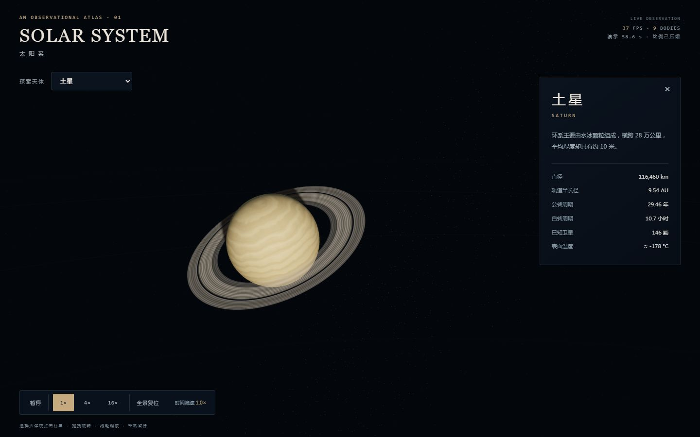

# 项目与工具作品集

这里汇集了我在 AI 应用、数据处理与可视化交互方面的个人实践。每个项目都附有源码、运行入口和验证说明，便于快速了解实现思路与实际边界。

## 推荐阅读

| 项目 | 解决的问题与展示重点 | 技术 | 入口 |
| --- | --- | --- | --- |
| **AnnoQA 标注规范问答** | 将规范文档分块并检索，返回相关片段及出处；无模型密钥时仍可使用检索模式 | Python、FastAPI、TF-IDF、pytest | [项目说明与运行方式](projects/annoqa/README.md) |
| **太阳系交互模型** | 可离线体验的 3D 天体展示，支持选择天体、视角控制和资料查看 | JavaScript、Three.js、esbuild | [项目说明](projects/3d-solar-system/README.md) · [画面预览](projects/3d-solar-system/docs/preview-saturn.png) |
| **AI Agent 工具** | 多模型后端路由、工具注册和分派的实践 | Python | [浏览源码](tools/ai-agent) |
| **数据处理工具** | 多模态模型调用、批处理及视频生成相关脚本 | Python、模型 API | [浏览源码](tools/data-pipeline) |

## AnnoQA：从文档到可追溯的检索结果

针对标注规范查找耗时的问题，项目将文档解析、分块、TF-IDF 排序、模型调用与 API 分层。检索结果包含来源；没有配置模型密钥时返回相关片段。词面检索不理解语义，不能替代人工核对规范。

在仓库根目录执行：

```bash
cd projects/annoqa
python -m venv .venv
# Windows PowerShell: .\.venv\Scripts\Activate.ps1
# macOS / Linux: source .venv/bin/activate
python -m pip install -r requirements.txt
python -m annoqa ingest docs/
python -m annoqa ask "3D 点云标注框的贴合误差怎么控制？"
python -m annoqa serve
```

服务启动后访问 `http://127.0.0.1:8000`。项目文档记录过 44 项测试通过及本地 HTTP 验证；真实模型端到端回答质量、检索量化指标和并发性能尚未验证。复现测试请在项目目录运行 `python -m pytest -q`。详见 [AnnoQA 说明](projects/annoqa/README.md)。

## 太阳系交互模型

通过菜单或点击选择太阳及八大行星，支持拖拽、缩放、暂停和速度调整。行星纹理由程序生成，单文件版本可离线打开：下载仓库后打开 `projects/3d-solar-system/web/solar-standalone.html`。

项目记录了 2026-10-26 的 Node 测试和浏览器检查，具体范围见 [验证记录](projects/3d-solar-system/VERIFICATION.md)。场景是艺术化展示，天体大小、距离和速度经过压缩，不是精确天文模拟。



## 其他内容

- [agents](agents) 与 [skills](skills)：Agent 定义和工作流配置，用于记录与复用任务方法。
- [resumes](resumes)：不同求职方向的简历版本；包含个人联系方式，请仅向适当对象分享。

各目录中的示例及工具有不同的依赖和配置要求，运行前请阅读对应说明。此仓库目前为私有仓库；查看者需要获得访问权限。仓库未声明开源许可证。

