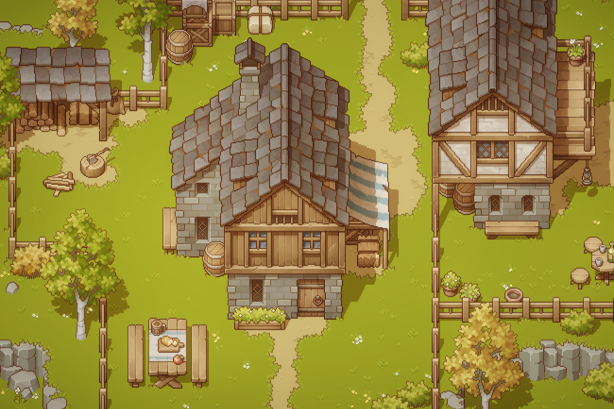
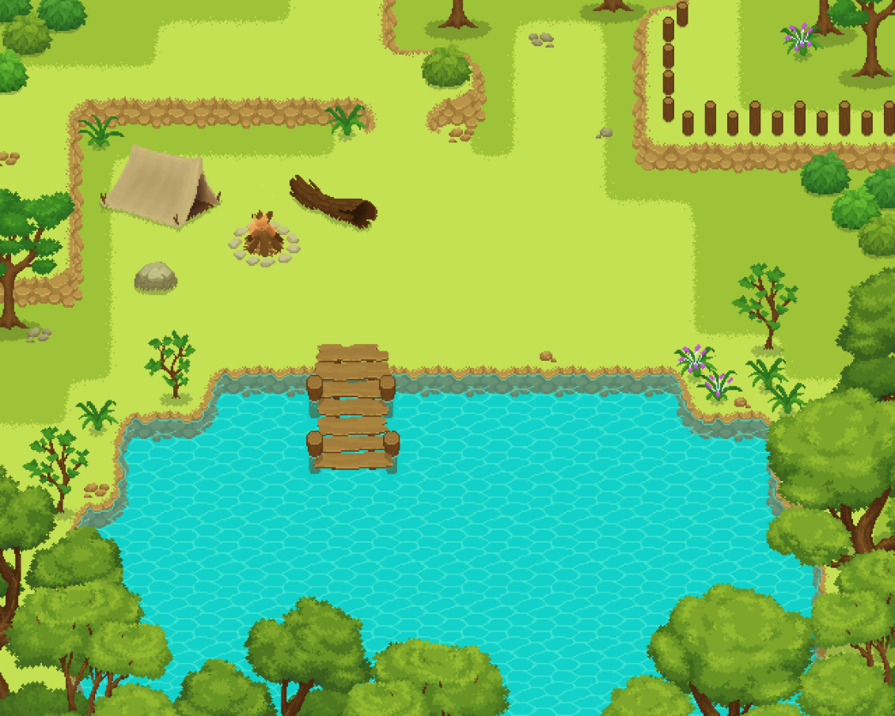

# 《灵镜档案》环境素材筛选 V4

日期：2026-10-14。阶段：真实素材选型；依据 docs/VISUAL_TARGET_V3.md 及用户指定参考图。未下载新素材ZIP、未购买、未接入或改代码。

## 结论

最终保留两套环境体系，均为32px网格。视觉主候选为Cainos Pixel Art Top Down - Village；低成本备选为schwarnhild Summer Plains。两者都不能承诺原样达到参考板；前者材质细节更接近，后者树与自然地形可作轻量环境试样。

原参考要求精细温暖、浓郁植被、多格树、自然路岸与木质界面。完整场景只是作者用该素材做出的效果，当前还没有核验下载包内的PNG、尺寸和转角集合，不能说已通过七类景物接入验收。

## 1. Cainos — Pixel Art Top Down - Village

作者页面：https://cainos.itch.io/pixel-art-top-down-village
免费同系列Basic：https://cainos.itch.io/pixel-art-top-down-basic
官方文档：https://docs.cainos.net/pixel-art-top-down-village/setup-guide

视觉观察：树冠由丰富叶片块面组成；树干、木屋、石墙、屋瓦与木围栏有清楚的材质、明暗和遮挡；草地保留安静底色，草簇和花分散为局部细节，土路边沿不生硬。其细节能力比上一套单格图标更接近用户参考。

差距：现有示例偏褐色中世纪村庄，绿色与装饰密度比参考克制；不是现成的蓝顶木屋、粉花农场方案。该包不是完整农业/UI/四季/角色体系，这些不应假定已覆盖。截图的高清细节不能用于推断每张源PNG尺寸。

页面规格：32×32；203 props、20 buildings、55 plants、terrain tileset、PSD与Unity demo。纹理允许在其他引擎使用，但Unity shader与demo场景不能直接移植。作者明确说明水面完全由shader生成，地形采用分层工作流，autotile并不保证完全兼容。

价格/授权：完整包当前至少US$39.99；同系列Basic免费，含3种树、15种草、草地与石路图集、独立阴影，可先用于核验树/草/石路。页面允许免费和商业项目、修改，署名可选，禁止素材再分发或转售。

Phaser结论：静态PNG接入可行性高；水面与地形转角还没有解决，不能因可加载PNG便认定能复现作者场景。优先验证免费Basic的树/草/石路，认可视觉后再决定是否购买Village。购买前列出符合项目边界的水面方案及缺件，不能为了示例水效重构正式renderer。

## 2. schwarnhild — Summer Plains Tileset and Asset Pack 32x32 Pixels

作者页面：https://schwarnhild.itch.io/summer-plains-tileset-and-asset-pack-32x32-pixels

视觉观察：大树冠有层次、树根与岩石有体积；岸线有转角与立面，水面可连接；草地安静，植被靠边缘成组。其手绘感与大树能力值得核验。

差距：主色偏明亮黄绿，缺少参考图的深色轮廓和高密度精细装饰；木围栏简单；不是完整农场、作物、房屋、HUD或四季体系。不能因为32px就认定达到目标。

页面规格：标准版含草/土/水地形、5种树、树干树桩、灌木、岩石、花草、木桥、简易木围栏。Plus增加动画水、瀑布、部分地形、木路、石材、分层木桥、井等。具体PNG透明度、帧表及路岸转角完整性仍需包内核验。

价格/授权：标准版免费；Plus当前至少US$4。作者允许商业/非商业项目及编辑，禁止转售或再分发。免费版按作者回复应署名，付费版署名非严格要求，项目采用统一署名。作者禁止AI训练，及使用AI工具改图、放大、重建或生成用于公开共享的衍生素材；评估和接入保持原始素材，不使用生成式图像编辑。

Phaser结论：常规图片/帧动画路径更轻，适合先检查七类景物是否齐全；仍需静态构图验收，视觉不能因技术容易而自动通过。

## 两套对照

| 维度 | Cainos Village | Summer Plains |
| --- | --- | --- |
| 细节与材质 | 更接近参考 | 更简洁，手绘感强 |
| 大树与草地 | 多层树冠，低噪点草底 | 多层树冠，明亮草底 |
| 路岸 | 自然土路；水是Unity shader | 页面有可用岸线与水动画，实际角集合待验 |
| 木质物件 | 丰富 | 围栏与物件较简单 |
| 费用 | US$39.99，Basic可免费试风格 | 标准免费，Plus US$4 |
| Phaser工程风险 | 水与地形需单独论证 | 相对较低，仍需包内检查 |
| 当前结论 | 视觉主候选，暂不购买 | 轻量备选，未认定视觉通过 |

## 排除记录

Mana Seed Summer Forest / RPG Starter Pack虽有精细森林表现，但作者现行统一许可证No GenAI条款禁止与AI生成代码、文字或图像共同用于项目，和本项目开发方式冲突，排除并未下载。
https://selieltheshaper.weebly.com/user-license.html

Farm and Fort为16px Time Fantasy扩展，不是本次优先的完整细腻环境体系；Sunnyside偏鲜艳幻想，reodesuxz仍为技术对照；不进入本轮最终两套名单。

## 下一步

先让用户查看本轮两张实际作者场景并确认视觉取向。推荐优先验证Cainos免费Basic的树、草、石路原图；它不包含完整样板，不能混入另一套素材补齐后宣称验证通过。视觉认可且水面方案确定后再考虑付费Village。若更喜欢Summer Plains，先验标准版，不先购买Plus。

用户确认过的范围仍为16×12样板，七类景物。当前没有购买授权，不发起付款、作者联系或新包接入。
