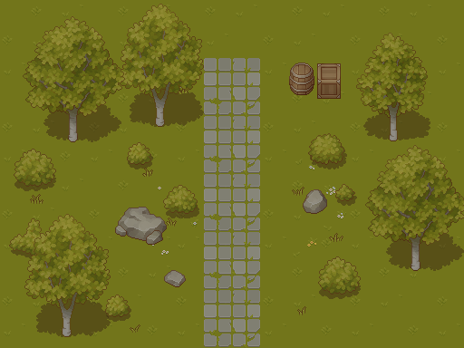

# Cainos Basic 免费素材实机核验

日期：2026-10-14。已下载官方Basic v1.2.3、解压、核验PNG，并完成独立Phaser风格预览。没有购买素材。

## 文件与授权

原ZIP：2,622,004字节，SHA-256为1307ddf193b5d6b1f0ff93c78dce2d793b4fa471d805eaa2164d072ce449afde。

ZIP包含11张纹理PNG、1200×1200 Scene Overview、Changelog、Documentation.url和Unity package。没有单独LICENSE文件；授权来自作者官方页面：https://cainos.itch.io/pixel-art-top-down-basic 。允许免费和商业项目及修改，署名可选，禁止再分发或转售素材包。

纹理均为RGBA PNG，含透明像素；大部分图集512×512，草地/石路256×256，角色128×128。草地基底几乎全不透明，这是铺地所需；阴影包含部分透明像素，不进行二值化。

三种树按Unity原始上下帧合并，原生完整尺寸为113×139、95×136、79×120。基础地形格32×32。导入JSON坐标从作者Unity meta转换，原PNG字节不改变；运行时合并上下树冠与树干，未重绘或放大。

## 实机预览

地址：http://127.0.0.1:5175/showcase.html?style=cainos

旧样板仍可用：http://127.0.0.1:5175/showcase.html

512×384画布、16×12基础格、相机zoom=1、原生1×显示。展示树、灌木、草簇、少量野花、石径、岩石、木箱与木桶。使用原阴影纹理，运行时alpha=0.4，石路采用连续图块。

当前只有风格验证，不是完整七类农场。这个免费包没有水面/岸线、土路、完整木围栏与门、农舍及四季农场内容；也没有参考板里的粉色花树和木质UI。不能用另一个风格补齐后宣称已达到参考效果。

## 检查结果

- 最终npm run typecheck与npm run build通过。
- 浏览器4 PNG + 4 JSON均HTTP 200，画布512×384，渲染完成。
- 独立页面没有创建localStorage数据。
- git diff确认FarmScene、placeholderAssets、domain、persistence及原地图没有改动。
- 当前无需新的领域回归用例；本轮未重跑183项既有测试，不把上一轮结果冒充本轮结果。

代码范围：新增src/showcase/CainosScene.ts；src/showcase-main.ts增加?style=cainos选择。新增public/farm-assets/cainos-basic原图、帧表及SOURCE.md。保留旧预览，入口修改前已备份并校验SHA。

## 视觉判断与下一步

树冠、树干、岩石与木质物件的原生细节确实优于先前单格占位素材；透明物件、多格尺寸和阴影都可在Phaser中正确显示。

当前配色偏橄榄绿/褐色，植物和花的丰富度仍弱于用户指定参考。技术接入通过，但这张图不代表完整农场美术已通过。下一步由用户查看实机风格，确认这个细节与比例方向；随后才明确免费路线的缺件补绘或同体系扩展范围，不默认购买Village。

状态：本地实现、构建和截图完成；未提交、推送或发布。
