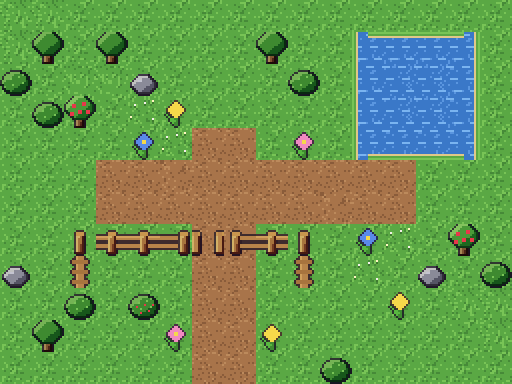
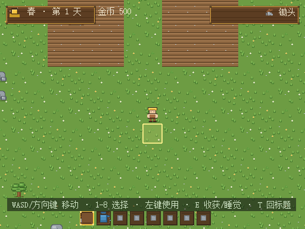

# 灵镜档案 · 16×12 样板验收

样板入口 `/showcase.html`：静态 512×384，16×12 格，原生 16px 素材按 2× 显示，相机 zoom=1。素材来自已下载的 reodesuxz Pixel Top-down Farm Tileset；仅加载所需 25 张 PNG。

独立入口不导入 GameSession、领域服务或存档管理器。草底、土路、水塘、树、岩石、花草、围栏均展示。透明物件在底图上叠加，整幅样板没有 HUD 遮挡。

## 检查结果

- 类型检查及 Vite 多页面生产构建通过。
- 现有回归测试 12 文件 / 183 项全部通过。
- 实机 PNG 请求 25 个，加载完成；样板没有创建 localStorage 数据。
- 生产资源目录中仍有完整 37 PNG + README/LICENSE。
- 正式 FarmScene、placeholderAssets、domain、persistence、原地图未修改。

## 视觉结论

同一素材体系具备统一颜色与透明叠加能力，技术上适合 Phaser。实际画面仍偏简化：树为单格小树，草地噪点密集且重复，土路没有过渡，水塘没有专用拐角。岸线裁切组合只能让矩形水塘连起来，不能替代完整岸线设计。

本次确认接入可行，不认定该素材已达到类似 Stardew Valley 的环境层次，也不认定画面已明显超过现有程序占位效果。用户查看样板后再决定是否作为正式主环境素材；当前不扩展全地图、作物、四季、房屋或 NPC。

本次没有新下载素材，没有提交、推送或发布。
