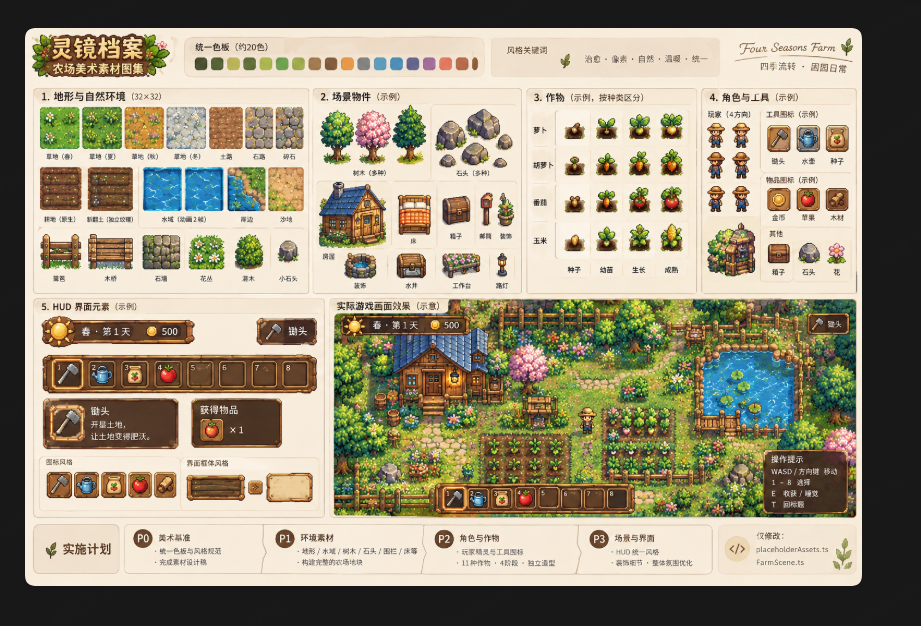

# 《灵镜档案》视觉基准 V3

日期：2026-10-14。

用户明确喜欢并提供了参考设定板。本文件优先于 ART_DIRECTION_V2.md 的视觉取向和候选优先级；既有功能范围不扩大。

## 固定方向

精细、温暖、浓郁的乡村像素插画风。俯视地形配可见正面的物件，树冠、岩石、木制物件有块面明暗与落地阴影。采用叶绿、深林绿、土褐、暖金和水蓝，蓝屋顶与粉花形成少量色彩焦点。

## 必须匹配的特征

| 维度 | 参考中的表现 | 验收要求 |
| --- | --- | --- |
| 树木 | 大树冠、多层叶片、清楚树干，树种轮廓不同 | 多格尺寸，具有体积，不以单格小图标代替 |
| 地面 | 草簇、花、泥土与石路组合，细节成团 | 丰富但有安静底面，重复纹理不显眼 |
| 路岸 | 石块边缘、土路过渡、水塘边沿和水面层次 | 自然内外角，水岸闭合，不用生硬矩形取代 |
| 物件 | 木、石、叶、金属各有可辨纹理和高光 | 统一光源，统一比例与像素密度 |
| 构图 | 房屋/水塘/农田为焦点，植被围合并彼此遮挡 | 焦点清楚，层次丰富，行走路径易读 |
| UI | 棕色木质框、金色边缘、凹槽与高光 | 后续专门规划，本轮不重做HUD |

参考板标注了32×32环境格，倾向优先评估原生32px环境素材。该标注不是实际可用图集测量结果；先核验候选包原生像素密度，再决定显示比例，保留现有逻辑格TILE=32。不得仅放大旧16px小图标，宣称已达到同等细节。

## 参考使用边界

该图片是用户指定的美术设定参考，目前没有逐件透明原图、标准格边界、动画帧说明和可核验素材许可，不能直接当已通过验收的游戏图集。即使概念预览看起来接近，也必须用实际PNG在浏览器渲染后验收。

图中流程文字仅是参考画面内容；不采用其改写placeholderAssets.ts或FarmScene.ts的建议作为工程指令。

## 修正素材路线

- reodesuxz样板保留为技术对照，不扩展为正式主环境。
- Sunnyside World和shubibubi Cozy Farm均回到候选状态，不再承诺与这张参考匹配。
- 选材先比完整场景与大树/草地/路岸原尺寸细节，不因“16×16、农场、能商用”就判视觉通过。
- 优先单一完整素材体系；如整体符合但有少量缺件，明确列出同风格定制范围和成本，再确定路线。

## 下一验收步骤

先比对“大树、草地、道路/岸线”三个核心部分。这三项若无法达到参考方向，就停止接入该包。通过后再组合16×12静态样板的七类景物，进行实际截图验收。最终房屋、角色、作物与HUD必须逐步与同一视觉基准统一，当前不提前改相关系统。

本轮仅保存参考和更新设计，不改代码、不下载新包、不购买或发布。
